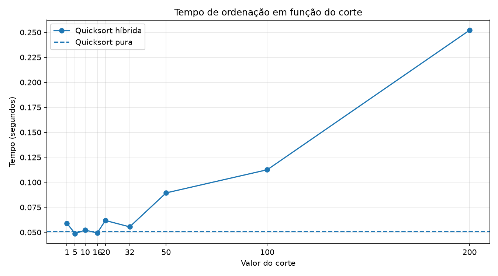

Dupla envolvida;
- Antonio Roberto Da Silva Santos
- Amanda Roberta Bandeira Santos

- Objetivo;

Implementar a ordenação rápida (quicksort) com pivô aleatório e combiná-la com a ordenação por inserção para trechos pequenos. O objetivo é analisar como o valor do parâmetro `corte` influencia o tempo de execução.

- Implementação;

A quicksort escolhe um pivô aleatório e separa os elementos em três grupos: menores, iguais e maiores que o pivô. Em seguida, ordena recursivamente os grupos menores e maiores.

Na versão híbrida, quando o tamanho do trecho é menor que `corte`, a ordenação por inserção é utilizada no lugar de novas chamadas recursivas da quicksort.

-- Metodologia;

- Quantidade de elementos: 20.000.
- Entrada: números inteiros aleatórios entre 0 e 100.000.
- Cortes testados: 1, 5, 10, 16, 20, 32, 50, 100 e 200.
- Repetições: 5 por configuração.
- Métrica: mediana dos tempos de execução, em segundos.
- Comparação: quicksort pura versus quicksort híbrida.

-- Resultados;

Preencher a tabela abaixo com os valores obtidos no arquivo `resultados.csv`.

| Corte | Tempo da híbrida (s) | Tempo da pura (s) | Ganho (%) |
|---:|---:|---:|---:|
| 1 | [valor] | [valor] | [valor] |
| 5 | [valor] | [valor] | [valor] |
| 10 | [valor] | [valor] | [valor] |
| 16 | [valor] | [valor] | [valor] |
| 20 | [valor] | [valor] | [valor] |
| 32 | [valor] | [valor] | [valor] |
| 50 | [valor] | [valor] | [valor] |
| 100 | [valor] | [valor] | [valor] |
| 200 | [valor] | [valor] | [valor] |

- Gráfico;

- Análise dos resultados;

-- Melhor corte --

O melhor resultado foi obtido com o corte **[valor]**, que apresentou tempo mediano de **[valor] segundos**.

Em comparação com a quicksort pura, cujo tempo mediano foi de **[valor] segundos**, o ganho foi de **[valor]%**.

- O que acontece com cortes grandes demais?

Quando o corte aumenta, a ordenação por inserção passa a ser utilizada em trechos maiores. Embora seja eficiente em listas pequenas, seu custo pode crescer quadraticamente com o tamanho do trecho. Assim, cortes excessivamente grandes podem aumentar o tempo total de execução.

- Comportamento do corte igual a 1

Com `corte = 1`, a condição para utilizar inserção não é satisfeita por nenhum trecho não vazio. Portanto, a versão híbrida executa a mesma estratégia de particionamento da quicksort pura.

Os tempos medidos podem apresentar pequenas diferenças devido à aleatoriedade dos pivôs, à sobrecarga das chamadas de função e às variações do ambiente de execução.

- Final

O experimento permite observar como a escolha do corte influencia o desempenho da ordenação híbrida. O melhor valor para os dados e o ambiente utilizados foi **[valor]**, conforme as medições realizadas.

Os resultados mostram a importância de combinar algoritmos de acordo com o tamanho dos trechos, em vez de utilizar necessariamente um único método em todas as situações.
